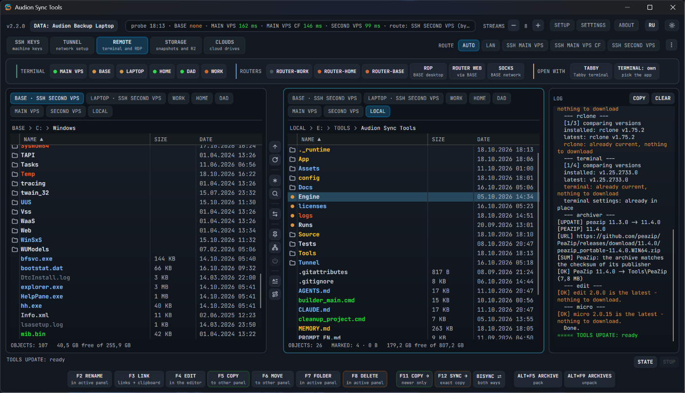

# Audion Sync Tools

<!-- audion:release -->

  
  
  
  

**Version 2.2.0** · 2026-10-18 · 148.6 MB

- [Direct download](https://audion.dev/get/sync-tools/2.2.0/Audion_Sync_Tools_v2.2.0_Full.zip) — unmetered, no rate limits
- [Project page](https://audion.dev/downloads/sync-tools) — every version and how to install

`SHA-256: 25b4e5bb02b9f85b66922a2207dd79cc34533119f66cb59b7f2d533091eeaa1b`

---

An **Audion** tool, published by [Tensionix](https://github.com/Tensionix).
<!-- /audion:release -->

[English README](Docs/README_EN.md) · [User Guide](Docs/USER_GUIDE_EN.md) | [Русский README](Docs/README_RU.md) · [Руководство](Docs/USER_GUIDE_RU.md)

**Contents**

- [Where to start](#where-to-start)
- [What lies where](#what-lies-where)
- [The window](#the-window)
- [Colours](#colours)
- [Routes to the home machines](#routes-to-the-home-machines)
- [Documentation](#documentation)
- [Rules worth knowing in advance](#rules-worth-knowing-in-advance)
- [OpenVPN from the data folder](#openvpn-from-the-data-folder)

The program that keeps a copy of MAIN VPS on this machine, together with
everything without which that copy is useless: the keys, the tunnel client, the
access to the home machines. Plus a snapshot of the private Build-stack archives
in the R2 bucket.

Nothing leaves it for the outside: no cards, no releases, no repositories.
Publishing is the work of Audion Build Publisher.

## Where to start

After Windows has been reinstalled: choose the former **DATA FOLDER**, then
**SETUP → RESTORE**. Before formatting, run **SSHD** once to save the host keys
into DATA. The order, the limits and the CLI: [restoring Windows](Docs/RESTORE_EN.md).

Start `Start.exe`. The window asks for administrator rights once — they are
needed to work with the system network connections: the tunnel service, the
state of the WireGuard interfaces and their handshakes are given by the system
only to an administrator. You may refuse: everything but the tunnels works
without the rights.

On a new machine the order is this:

1. unpack the program and bring this machine's data folder with it —
   `Audion Backup <Machine>`;
2. start `Start.exe`: the first-run window asks for the data folder and
   downloads the tools a release comes without — `rclone`, `cloudflared`, the
   terminal, PeaZip and the editors;
3. `SETUP` → `IMPORT KEYS` — lays the keys into the three places the programs
   look for them; `Runs\import-keys.cmd` does the same;
4. `STORAGE` → `SYNC ALL` — the first filling of the mirror. After that the
   mirror is refreshed by the same button or by `Runs\sync-backup.cmd`: the
   program creates no tasks in Windows Task Scheduler, and MAIN VPS takes its
   nightly snapshot itself, by its own timer.

To confirm it all landed: the `DIAGNOSTICS` button in the TUNNEL section, or
`Tunnel\RemoteDesktop\check-routes.cmd` from a console.

## What lies where

**The program** is this folder: the window, the scripts, its own `rclone`, the
tunnel client. There is not a single file here that would be painful to lose:
no keys, no addresses, no passwords — only a pointer to the profile.

**The data** is the neighbouring `Audion Backup`: snapshots, six mirrors of
MAIN VPS's code, keys, tokens. There is not a single executable file there.

**The machine profile** is the data folder itself: every machine has its own,
for example `Audion Backup Laptop` or `Audion Backup Work`. It holds what makes
this machine differ from the same program at another person's: rclone.conf, the
R2 keys, the host fingerprints, the addresses of the machines, the plan of the
mirror, the router password. The settings of the window — the theme, the
language, the terminal — are part of the program and do not go into the profile.

The name of the profile is given by a person — `Laptop`, `Work`, `Base` —
because the data folder is carried between machines, and the name of a computer
at work cannot be changed. The program itself keeps only a pointer to the
profile: `config\profile.json`, two lines. Everything else it takes from the
profile and writes back there.

The working files of the connections lie only in the data folder: the program
does not keep them. To see them as a list, use the `LIST` button in the SSH
KEYS section.

The path to the data is counted from where the program lies. If the data lies
elsewhere, the path is given by the `-Root` switch — of the window and of every
wrapper. No drive letter is hard-coded anywhere: on the laptop it is `E:`, on
the workstation `S:`.

    Start.exe                       starts the window
    Runs\sync-backup.cmd            the mirror of MAIN VPS
    Runs\import-keys.cmd            lay the keys out
    Runs\export-keys.cmd            collect Export Keys into Tunnel\Export
    Runs\backup.cmd                 PRIVATE BACKUP: the Build-stack archives into R2
    App\                            the window and its own PowerShell 7
    Engine\                         the scripts
    Tunnel\                         the tunnel client
    Tunnel\RemoteDesktop\           access to the machines, the router, the routes
    Tools\                          rclone, the terminal, PeaZip, the editors
    config\                         the version, the pointer to the data folder, the settings of the window
    logs\                           the logs of the window and of the wizards

## The window

Two file panels are always visible, and the section strip at the top changes
only what is open in them and which row of buttons is shown: SSH KEYS, TUNNEL,
REMOTE, STORAGE and CLOUDS; SETUP, SETTINGS and ABOUT are buttons at the top right. On the right is the log, between
the panels a narrow strip of buttons, at the bottom the row of file operations
with their keys. A local disk, a machine over ssh, an R2 bucket and a cloud are
the same to the program: one `rclone` reads them all, and copying goes between
any two sides.

In the header: the DATA badge with the name of the data folder, the probe line
(which route answered in how long, and which way the window will go), the
number of threads, the language RU / EN and the theme button: Audion Vault
Dark, Audion Dark, Audion Code Dark and Audion Light. The choice is remembered
between runs.

The `SETUP` and `SSH KEYS` sections show what this machine has already got: the
addresses of the machines, the ssh keys, the keys to R2, the list of host keys,
sshd, the router password. Every button has an indicator: grey — this is not
there yet, orange — it is there but not confirmed by doing, green — confirmed by
reading a panel. `REMOVE TASK` stands apart: it removes the daily task left
from former versions, and is visible only while such a leftover exists.

The machines — BASE, LAPTOP, MAIN VPS, HOME, WORK and the routers — stand in
the REMOTE section: the button of a machine opens a terminal on it. The set of
buttons is given by `targets.json`; a machine whose address is not written in
yet has a grey indicator, and a press says so in words. MAIN VPS stands in the
panels beside the home machines and the R2 bucket: a file travels between the
R2 bucket and MAIN VPS directly, with no scp and no console.

The keys are those of a file manager: Space marks, Enter goes in, Backspace
goes a level up, Tab moves to the other panel. F2 — rename, F3 — public links
to what is marked in the R2 bucket, F4 — the editor, F5 and F6 — copy and move,
F7 — a folder, F8 — delete. F11 adds what is missing to the other panel, F12
makes it an exact copy of the active one. Alt+F5 and Alt+F9 pack and unpack
archives, Ctrl+F searches from the folder of the panel downwards, the F key
narrows the list by name. Esc stops the running operation.

The asterisk in the strip between the panels marks rows by masks: masks of
one's own, saved sets, the time of change and groups of extensions. The
magnifier opens the search — the same on a disk, on a machine, in the R2 bucket
and in a cloud; what is found can be put into a panel as one flat list.

The `STATE` button under the log reads the panels again and writes a summary:
the age of the snapshot, the R2 keys, the version of `cloudflared`, sshd and
the tunnels of this machine — its own and those of someone else's VPN. The same
summary appears at start.

The program carries its tools with it and updates them itself: `SETTINGS →
UPDATE` looks after `rclone`, `cloudflared`, the terminal, PeaZip and the
editors. Versions are asked before anything is downloaded, so what is already
fresh is not downloaded again. The data folder, the font, the transparency and
sizes shown in bytes are there too.

In detail — in the [user guide](Docs/USER_GUIDE_EN.md).

## Colours

The names of files and folders are coloured by `App\config\colors\themes.json`:
it holds the colours and the order of the rules for the dark and the light
sides. What counts as video, a document or an archive is said by
`App\config\mask-groups.json` next to it — the same families as in the mask
window; there is no second list of extensions in the program. The colours are
taken from the owner's Total Commander themes.

The rules go from top to bottom, and the first that fits wins — as in TC
itself. So freshness usually matters more than type: a file changed today is
coloured "not older than a day" even if it is an archive. Age counts in
calendar days: yesterday's file is "not older than a day" even when it is
thirty hours old.

The colours of the window itself — the frames, the buttons, the background of
the list — live apart, in the themes of the window, and do not affect the
colours of the rows.

## Routes to the home machines

From home everything goes directly. From someone else's network — through the
jump host MAIN VPS: first by name, then over cloudflared, and SECOND VPS stays
as the last. The route is chosen by the probe, and the `ROUTE` buttons in the
section strip let you insist on your own: `AUTO`, `LAN`, `SSH MAIN VPS`,
`SSH MAIN VPS CF`, `SSH SECOND VPS`. The caption of the source above a panel
says which way the call goes: `BASE · SSH MAIN VPS CF`. Where the common choice
does not fit, a button in the strip between the panels gives each machine a
route of its own.

## Documentation

    README.md                the pointer to the descriptions and the guides
    Docs\README_EN.md        this description
    Docs\README_RU.md        the same in Russian
    CLAUDE.md                the rules of working with the project
    MEMORY.md                the history: why it is built this way
    SKILL.md                 commands, checks, configs
    Docs\USER_GUIDE_EN.md    the user guide
    Docs\USER_GUIDE_RU.md    the same in Russian
    Docs\RESTORE_EN.md       restoring after Windows has been reinstalled
    Docs\RESTORE_RU.md       the same in Russian
    Docs\CHANGELOG_EN.md     the changelog
    Docs\CHANGELOG_RU.md     the same in Russian

The register of accesses — which key opens what, where which tunnels are —
lives in the data: `Audion Backup\Tunnel\ACCESS.md`. The values of secrets are
never copied there, only paths and purposes.

## Rules worth knowing in advance

**Take nothing from the neighbouring projects.** The program has its own
`rclone` and its own keys; a change that brings back a tie to the neighbours is
a wrong change.

**Do not clean the data.** `Audion Backup` is not deleted and not "put in
order": the keys, the tokens and the only local copy of MAIN VPS are there.

**A button calls a wrapper.** Nothing must happen in the window that cannot be
done from a console — otherwise the window and the wrappers drift apart.

**The owner edits the keys.** The program repairs permissions and paths, the
content of the keys — never.

## OpenVPN from the data folder

`TUNNEL → NET → OPENVPN` offers to connect the VPN and open the disks of WORK
in the active panel, or to disconnect the chosen VPN profile. After the request
to connect, the program waits up to 90 seconds for `work:/` to be read through
rclone, with the keys and the server check of the working rclone.conf. A
sign-in error does not count as a ready connection. On a new machine IMPORT
KEYS, RCLONE.CONF and the trusted keys of WORK are needed first.
`SETUP → OTHER → OVPN PATH` lets you choose the client and the profile;
Ctrl+OPENVPN checks the paths without connecting. The same is available through
`Tunnel\RemoteDesktop\openvpn.cmd` and `openvpn-path.cmd` with the `-Root`
switch.

The portable layout: `DATA\OpenVPN Portable\openvpn-portable.exe`, `app` beside
it, the profile in `data\config\*.ovpn`, the RDP file next to the client. The
owner provides these files; they are not part of a Sync Tools release. If the
system OpenVPN GUI is installed, it is found automatically; an explicit choice
of the client is saved in the data and takes priority. The external client is
started through UAC. To disconnect, use the same OPENVPN button or the client's
tray icon; STOP is meant for file operations. The CLI has `-Connect` and
`-Disconnect`. OpenVPN gives the route to WORK; the SSH/SFTP connection for the
panels is made by rclone. Simultaneous VPN connections from different machines
need profiles allowed by the administrator of the server: copies of one
certificate may push each other out.
